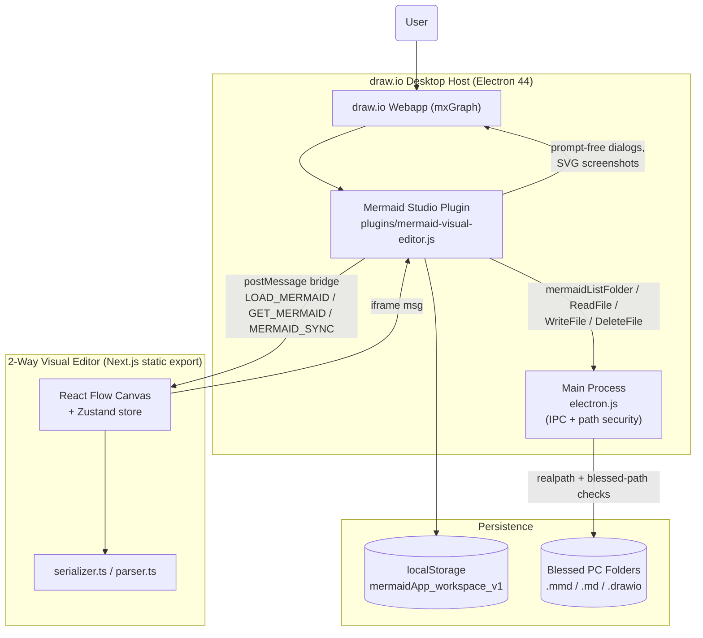
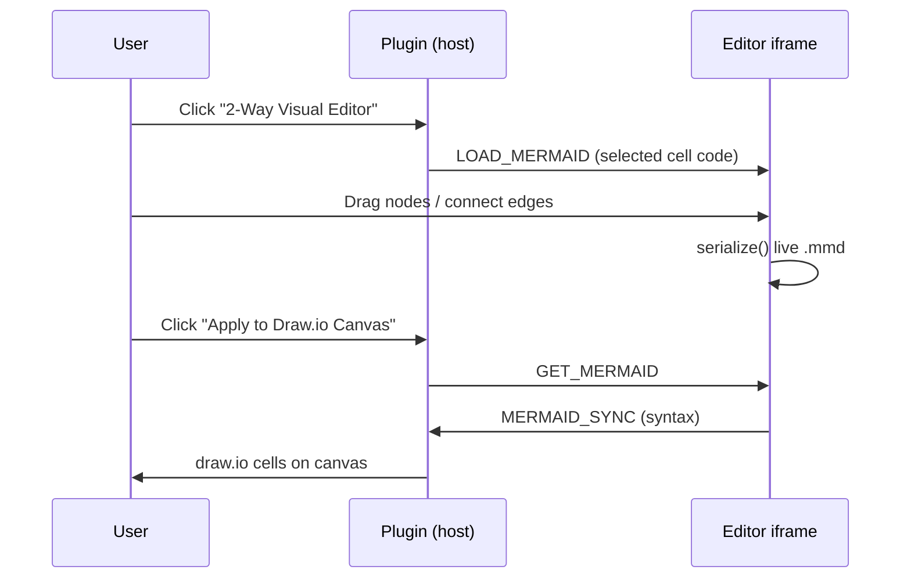
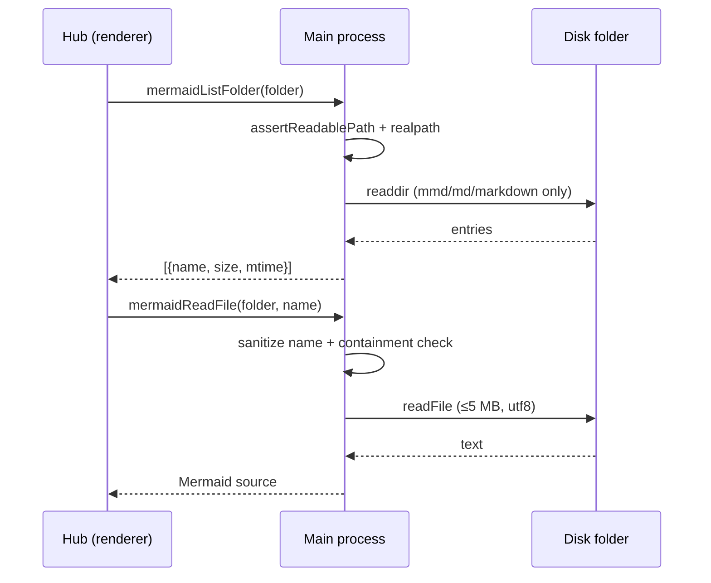
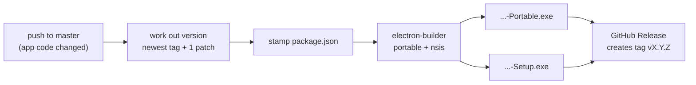

# System Architecture (`ARCHITECTURE.md`)
> **1-Line Summary:** Plain-English visual map of how the app works, why we chose each tool, and step-by-step recipes for adding new features.

## 1. High-Level Visual System Map

## 2. Tech Stack & Why We Chose It

| Layer | Tool / Library | Plain-English Reason Why |
| --- | --- | --- |
| Host / UI | draw.io Desktop fork (Electron 44 + mxGraph) | Full diagram editor for free; our features inject as one plugin |
| Visual editor | Next.js 16 static export + @xyflow/react 12 + Zustand + dagre | Drag-and-drop canvas that exports to plain `.html`/`.js` loads inside draw.io over `file://` |
| Diagram engine | mermaid 11.12 (inside draw.io's own parser) | Keeps diagrams as editable text and matches draw.io's native Mermaid rendering |
| Disk access | Electron IPC (rendererReq actions) | The web sandbox cannot touch the disk; the main process enforces draw.io's blessed-path security model |
| Cloud builds | GitHub Actions windows-latest + electron-builder | Free cloud compile of the portable `.exe` on every tag; nothing heavy stored in Git |
| Package manager | pnpm (editor), npm (drawio-desktop) | Matches each upstream project's own tooling |

## 3. Core Subsystems & Engineering Tricks

### [SUBSYSTEM: Plugin Injection Lifecycle] | Aliases: plugin loading, idempotent registration, duplicate palettes
> **1-Line Summary:** The whole studio injects as a single webapp plugin that draw.io loads after its async bootstrap, guarded by a window-global flag so palettes and buttons register exactly once.
* **How It Works (Plain English):** `ElectronApp.js` calls the plugin right after `App.initPluginCallback()`; the plugin guards with `window.__mermaidStudioPluginInitialized` and stamps `ui.sidebar._customMermaidPalettesAdded` before adding palette functions.
* **Code Anchors (Grep Targets):**
  * `drawio-desktop/drawio/src/main/webapp/plugins/mermaid-visual-editor.js` -> `initMermaidStudioPlugin`, `window.__mermaidStudioPluginInitialized`
  * `drawio-desktop/drawio/src/main/webapp/js/diagramly/ElectronApp.js` -> mxscript injection after `App.initPluginCallback()`

### [SUBSYSTEM: Two-Way PostMessage Bridge] | Aliases: LOAD_MERMAID, GET_MERMAID, MERMAID_SYNC, iframe bridge
> **1-Line Summary:** The React editor lives in an iframe and talks to the plugin through four message types so the canvas and the Mermaid text never drift apart.
* **How It Works (Plain English):** `MERMAID_EDITOR_READY` → parent pushes selected cell code with `LOAD_MERMAID`; user edits; `GET_MERMAID` asks the editor to reply with `MERMAID_SYNC`; `Apply to Draw.io Canvas` converts the text into real mxCells.
* **Data Flow Diagram:**

* **Code Anchors (Grep Targets):**
  * `drawio-desktop/drawio/src/main/webapp/plugins/mermaid-visual-editor.js` -> `openVisualMermaidEditor`, `applyMermaidToCanvas`, `window.addEventListener('message')`
  * `mermaid-visual-editor/app/page.tsx` -> `handleMessage`

### [SUBSYSTEM: Blessed-Path IPC Disk Access] | Aliases: folder authorization, mermaid IPC, file security
> **1-Line Summary:** The hub's disk powers go through four main-process actions that only trust folders the user picked in the native dialog, re-deriving every child path safely on the trusted side.
* **How It Works (Plain English):** `showOpenDialog` blesses the picked folder (persisted in `%APPDATA%\draw.io\config.json` under `blessedPaths`). Each IPC call re-checks the blessing with native realpaths, sanitizes the child name (no `..`, no separators, no Windows device names), keeps it inside the folder, and caps content at 5 MB with an extension allow-list.
* **Data Flow Diagram:**

* **Code Anchors (Grep Targets):**
  * `drawio-desktop/src/main/electron.js` -> `mermaidAuthFolder`, `mermaidContainedChild`, `reqMermaidName`, `showOpenDialog`, `assertWritablePath`, `assertReadablePath`
  * `drawio-desktop/drawio/src/main/webapp/plugins/mermaid-visual-editor.js` -> `ipcRequest`, `pickDiskFolder`, `scanDiskFolder`

### [SUBSYSTEM: Contrast-Safe SVG Pipeline] | Aliases: light-dark, contrast inversion, dark mode text
> **1-Line Summary:** Every SVG the studio previews has its `light-dark()` pairs resolved with paren-aware parsing and its `color-scheme` pinned, so OS dark mode can never invert text on a light canvas.
* **How It Works (Plain English):** draw.io emits `fill: light-dark(a, b)` with commas inside `rgb(...)`. A naive comma split mangles them. `splitLightDarkArgs` walks the args with parenthesis depth, picks the value for the canvas being drawn on, and rewrites `color-scheme` to match.
* **Code Anchors (Grep Targets):**
  * `drawio-desktop/drawio/src/main/webapp/plugins/mermaid-visual-editor.js` -> `resolveLightDarkCss`, `splitLightDarkArgs`, `parseCssColor`, `contrastRatio`

### [SUBSYSTEM: Visual Editor Bundle Sync] | Aliases: next build, bundle swap, out directory, hydration
> **1-Line Summary:** A sync script builds the Next.js editor and atomically swaps it into the webapp, keeping absolute `/_next/` URLs so the Turbopack runtime can still find its chunks over `file://`.
* **How It Works (Plain English):** Build → verify every referenced chunk exists on disk → stage a fresh copy → swap the directory in one rename → re-check for stale chunks. electron.js redirects any `/_next/*` request into the bundled folder.
* **Code Anchors (Grep Targets):**
  * `scripts/sync-visual-editor.cjs` -> build pipeline + `fs.renameSync` swap
  * `drawio-desktop/src/main/electron.js` -> `onBeforeRequest` `/_next/` redirect

## 4. Verification & Health Checks

### [VERIFY: Automated Check Suite] | Aliases: test commands, build check, regression, CDP verification
> **1-Line Summary:** Commands every AI must run to prove nothing broke before committing.

* **Syntax gates (main process + plugin):**
  `node --check drawio-desktop/src/main/electron.js`
  `node --check "drawio-desktop/drawio/src/main/webapp/plugins/mermaid-visual-editor.js"`
* **Editor build:** `node scripts/sync-visual-editor.cjs` (builds with Next/Turbopack, fails on missing chunks)
* **Editor unit tests:** `node --test mermaid-visual-editor/lib/fileio.test.ts mermaid-visual-editor/lib/serializer.test.ts mermaid-visual-editor/lib/store.test.ts`
* **End-to-end app regression (real Electron over CDP):** `node scripts/verify-ipc-integration.mjs <drawio-desktop path>` — asserts hydration, hub dialogs, IPC round-trip, and security refusals
* **Packaged exe regression:** `node scripts/verify-packaged-exe.mjs <releases path>`
* **Portable + installer packaging:** `cd drawio-desktop; node ./sync.cjs; $env:DRAWIO_UNSIGNED='true'; npx electron-builder --config electron-builder-win.json --publish never` (produces both `-Portable.exe` and `-Setup.exe`)

## 5. Repository, Licensing & Cloud Build

### [SUBSYSTEM: Single-Repo Source with Auto-Versioned Cloud Releases] | Aliases: GitHub Actions, portable exe, installer, auto tag, release, flattened repo
> **1-Line Summary:** One Git repository (no submodules); every app-code push to `master` auto-bumps the version, creates the tag, and publishes both the portable `.exe` and the Windows installer from `windows-latest`.

* **Repository:** <https://github.com/Mostakim2005/mermaid-manager> (default branch `master`).
* **Why flattened:** the old root repo stored `drawio-desktop/` and `mermaid-visual-editor/` only as gitlinks and had no `.gitmodules`, so a cloud runner could never check them out. Both nested repos (and `drawio-desktop/drawio`, upstream's submodule) are now ordinary source directories. The nested `.git` folders were preserved in `..\MermaidApp-git-backup\` on the build PC.
* **Deliberately not in Git:** `node_modules/`, `releases/`, `dist/`, `win-unpacked/`, `.next/`, `out/`, `resources/` (cloned companion tools), logs and `.env` files.
* **Version rule (release tag is the source of truth):** on a push to `master` the workflow takes the newest `v*` tag, compares it with `drawio/VERSION`, and uses the next patch (or `drawio/VERSION` when that is newer). It stamps that number into `package.json` after `sync.cjs`, builds, and lets the release create the tag. Pushing a `v*` tag rebuilds that exact version; `workflow_dispatch` can take an explicit version.
* **Two artifacts per release:** `MermaidApp-draw.io-v<version>-Portable.exe` (no install) and `MermaidApp-draw.io-v<version>-Setup.exe` (per-user NSIS wizard, no admin rights, Start Menu + Desktop shortcuts, optional install folder).
* **Licensing:** root `LICENSE` is GNU General Public License v3.0 (GPL-3.0-only), harmonizing with vendored `drawio-desktop/` (GPL-3.0-only). Subcomponents retain permissive compatible licenses: `drawio-desktop/drawio/` Apache-2.0, `mermaid-visual-editor/` MIT. All credits are in `THIRD_PARTY_NOTICES.md`.

* **Code Anchors (Grep Targets):**
  * `.github/workflows/build.yml` -> `Work out the release version`, `Stamp the release version into package.json`, `Publish GitHub Release`
  * `drawio-desktop/electron-builder-win.json` -> `win.target` (`portable`, `nsis`), `nsis.artifactName`
  * `drawio-desktop/sync.cjs` -> `disableUpdate` writer

## 6. Recipes: How to Add New Things Safely

* **To add a new toolbar button:** edit `plugins/mermaid-visual-editor.js` -> `injectNativeToolbarButtons` (use class `mermaid-tb-btn`; reuse `openUniversalStudio`/`openVisualMermaidEditor` for actions).
* **To add a new diagram type to the Studio:** extend `detectDiagramType` with a new header regex, then add a render branch in `renderCurrentCode` (mirror the radar/infographic engines for custom SVG renderers).
* **To add a new auto-fix rule:** append a repair function in the auto-fixer section, register it in the ordered `steps` list of `autoFixSyntaxDetailed`, and keep it idempotent (running it twice must not change output).
* **To add a new IPC disk action:** follow the `mermaidWriteFile` pattern — `reqStr` every argument, route through `mermaidAuthFolder` + `mermaidContainedChild`, and cap content size.
* **To add a new hub folder type:** extend the folder object in `addDiskFolder`, guard rendering with a `kind` check like `isDiskFolder`, and update the delete/rescan branches in `renderHubView`.
* **To rebuild everything after changing the visual editor:** `node scripts/sync-visual-editor.cjs` then re-run the verification suite above; never hand-copy `out/` into the webapp.
