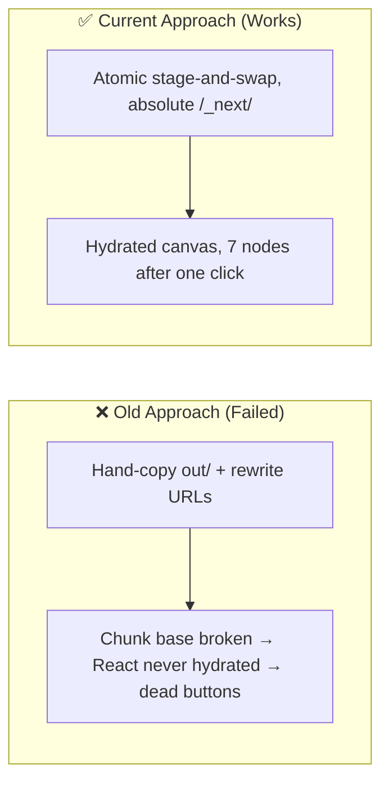

# Architectural Decisions, Pivots & Landmines (`DECISIONS_AND_TRAPS.md`)
> **1-Line Summary:** Records why we chose specific approaches, what failed when we tried other ways, who made the decision, and critical code traps never to touch.

## 1. Architectural Decisions & Pivot History

### [DECISION: Atomic Editor Bundle Sync] | Aliases: visual editor bundle, out folder copy, hydration fix
> **1-Line Summary:** The visual editor is deployed by an atomic stage-and-swap sync script that keeps absolute `/_next/` URLs, replacing a hand-copy that left the editor rendered but dead.
* **Decision Maker:** `[DECIDED BY: AGENT - Approved by Human]`
* **Original User Intention:** The 2-Way Visual Editor's buttons must actually work when the app opens.
* **Options Considered:**
  * **Option A (Rejected):** Hand-copy `out/` into the webapp and rewrite `/_next/` to `./_next/` — the Turbopack runtime derives its chunk base from the script URL, so relative paths plus a chunk folder mixing several builds left React unhydrated: the UI drew but every button was inert.
  * **Option B (Chosen):** `scripts/sync-visual-editor.cjs` builds, verifies every referenced chunk exists, stages a fresh copy, swaps it in with one rename, and re-checks for stale chunks. Absolute `/_next/` URLs are preserved because `electron.js` redirects them into the bundled folder.
* **Visual Pivot Map (What Failed vs. What Works):**

* **Code Anchors (Grep Targets):**
  * `scripts/sync-visual-editor.cjs` -> swap pipeline
  * `drawio-desktop/src/main/electron.js` -> `onBeforeRequest` `/_next/` redirect

### [DECISION: In-App Dialogs Replace Native Prompt] | Aliases: prompt not supported, new folder error, confirm dialog
> **1-Line Summary:** All hub prompts/confirms run as DOM dialogs because Electron deletes `window.prompt()`, so the native call threw "prompt() is not supported" mid-handler.
* **Decision Maker:** `[DECIDED BY: AGENT - Approved by Human]`
* **Original User Intention:** Clicking "New Folder" must create a folder, not show an error.
* **Options Considered:**
  * **Option A (Rejected):** Catch the prompt error and fall back to `confirm()`-style native flows — `confirm()` also blocks the renderer and cannot collect text input.
  * **Option B (Chosen):** Theme-aware `inAppDialog()` with `appPrompt`/`appConfirm` wrappers; every call site converted; key events are capture-phase stopped so dialog typing never leaks into draw.io canvas shortcuts.
* **Code Anchors (Grep Targets):**
  * `drawio-desktop/drawio/src/main/webapp/plugins/mermaid-visual-editor.js` -> `inAppDialog`, `appPrompt`, `appConfirm`

### [DECISION: Blessed-Path IPC for Disk Access] | Aliases: PC folders, file permissions, folder authorization
> **1-Line Summary:** Hub disk access goes through four dedicated main-process IPC actions reusing draw.io's blessed-path security model, instead of a blanket file-system grant or a webkitdirectory picker workaround.
* **Decision Maker:** `[DECIDED BY: AGENT - Approved by Human]`
* **Original User Intention:** Import real `.mmd`/`.md` folders from the C: drive into the hub and keep them synced, without weakening app security.
* **Options Considered:**
  * **Option A (Rejected):** `<input webkitdirectory>` — the browser keeps no real paths, cannot re-scan without re-picking, and cannot write at all.
  * **Option B (Rejected):** Grant the renderer generic `fs` access — breaks draw.io's security posture (a renderer XSS could read/write anything).
  * **Option C (Chosen):** `mermaidListFolder/ReadFile/WriteFile/DeleteFile` in `electron.js`; folders are blessed by the native dialog and persisted; child paths are sanitized and realpath-contained on the trusted side.
* **Code Anchors (Grep Targets):**
  * `drawio-desktop/src/main/electron.js` -> `mermaidAuthFolder`, `mermaidContainedChild`, `reqMermaidName`

### [DECISION: Paren-Aware Light-Dark Resolver] | Aliases: contrast fix, dark mode inversion, color-scheme
> **1-Line Summary:** The contrast resolver splits `light-dark()` arguments with parenthesis-depth tracking instead of a naive comma split, and pins `color-scheme` per canvas.
* **Decision Maker:** `[DECIDED BY: AGENT - Approved by Human]`
* **Original User Intention:** Text must stay readable when switching light/dark themes.
* **Options Considered:**
  * **Option A (Rejected):** `light-dark\(([^,]+),([^)]+)\)` — draw.io emits `rgb(236, 236, 255)` whose commas break the split, leaving some pairs unresolved to be re-evaluated by the OS theme.
  * **Option B (Chosen):** Depth-aware `splitLightDarkArgs` + explicit `color-scheme` rewrite; verified 0 unresolved pairs on real renders in both themes.
* **Code Anchors (Grep Targets):**
  * `drawio-desktop/drawio/src/main/webapp/plugins/mermaid-visual-editor.js` -> `splitLightDarkArgs`, `resolveLightDarkCss`

### [DECISION: PolyForm Noncommercial License] | Aliases: license, attribution, third-party notices
> **1-Line Summary:** The project ships under PolyForm Noncommercial 1.0.0 with all upstream MIT/Apache/GPL credits collected in `THIRD_PARTY_NOTICES.md`, keeping license and attribution separate.
* **Decision Maker:** `[DECIDED BY: HUMAN]`
* **Original User Intention:** Free for personal/noncommercial use with correct credit to draw.io, Next.js, React Flow, Mermaid and friends.
* **Code Anchors (Grep Targets):**
  * `LICENSE`, `THIRD_PARTY_NOTICES.md`

### [DECISION: One Flattened Repository for Cloud Builds] | Aliases: submodules, gitlinks, nested repos, checkout
> **1-Line Summary:** The three nested repositories were flattened into one repository because a cloud runner cannot check out unpublished gitlinks, and the old root repo had no `.gitmodules` at all.
* **Decision Maker:** `[DECIDED BY: AGENT]`
* **Original User Intention:** Put the whole codebase on GitHub and have a tag build the portable `.exe` in the cloud.
* **Options Considered:**
  * **Option A (Rejected):** turn `drawio-desktop/` and `mermaid-visual-editor/` into real submodules and publish them as separate repos. Rejected because their custom commits would need three public repos, three push orders, and a workflow that authenticates a private-checkout chain — fragile for one person's project.
  * **Option B (Chosen):** vendor every source directory into the root repo, delete the gitlink entries, and keep nested history in a local backup. One checkout gives the workflow everything it needs.
* **Consequence:** upstream commit history for the two nested repos is no longer inside this repository (it is backed up locally); future changes are committed once, at the root.
* **Code Anchors (Grep Targets):**
  * `.gitignore`, `.gitattributes`
  * `.github/workflows/build.yml`

### [DECISION: Release Tag Is the Version Source of Truth] | Aliases: auto version, version bump, tag, package.json, release
> **1-Line Summary:** The workflow works out the version from the newest `v*` tag (auto-bumping the patch), stamps it into `package.json` after `sync.cjs`, and lets the release create the tag, so versioning is never manual.
* **Decision Maker:** `[DECIDED BY: AGENT]`
* **Original User Intention:** "Git versioning is always updated, like tag versioning, if necessary."
* **Options Considered:**
  * **Option A (Rejected):** keep `drawio/VERSION` as the built version and require a matching manual tag. `sync.cjs` overwrites `package.json` from that file, so a pushed tag could never change the built version, and every release needed hand bookkeeping.
  * **Option B (Chosen):** derive the next version from the newest tag (`newest patch + 1`, or `drawio/VERSION` when upstream jumps ahead), stamp it into `package.json`, and publish the release with that tag. An app-code push to `master` releases automatically; docs-only pushes are filtered out.
* **Consequence:** the repo's `package.json` keeps drawio's upstream number between builds; the built app and the release use the tag version. A pushed `v*` tag still rebuilds exactly that version, and `workflow_dispatch` can take an explicit one.
* **Code Anchors (Grep Targets):**
  * `.github/workflows/build.yml` -> `Work out the release version`, `Stamp the release version into package.json`
  * `drawio-desktop/electron-builder-win.json` -> `nsis.artifactName`

---

## 2. Do-Not-Touch Engineering Landmines (Traps)

### [TRAP: Config JSON BOM Breaks Blessed Paths] | Aliases: path not authorised, electron-store parse error, config.json
> **1-Line Summary:** Never write `%APPDATA%\draw.io\config.json` with a PowerShell 5.1 UTF-8 BOM — electron-store's parse fails silently and every authorized folder access reports `path not authorised`.
* **Strict Rule:** **NEVER** edit `config.json` with `Set-Content -Encoding UTF8` (PS 5.1). Use `[System.IO.File]::WriteAllText(path, json, [System.Text.UTF8Encoding]::new($false))` and confirm the first three bytes are not `239,187,191`.
* **Why This Trap Exists (Plain English):** electron-store reads the file with `JSON.parse`, which rejects a BOM character; the store initializes empty, `blessedPaths` loads as nothing, and the security layer then (correctly) refuses every folder. The symptom looks like a code bug but is a storage-format bug.
* **Protected Code Anchors (Grep Targets):**
  * `drawio-desktop/src/main/electron.js` -> `BLESSED_PATHS_KEY`, store init try/catch

### [TRAP: Visual Editor Hydration Depends on Absolute Next URLs] | Aliases: dead buttons, canvas is empty, turbopack chunks
> **1-Line Summary:** Never rewrite the bundled editor's `/_next/` URLs to relative paths or mix chunk files from different builds — the Turbopack runtime then never boots and every editor button goes dead.
* **Strict Rule:** **NEVER** hand-copy `mermaid-visual-editor/out/` into the webapp or regex its HTML. Always deploy through `scripts/sync-visual-editor.cjs`, which stages and atomically swaps the directory.
* **Why This Trap Exists (Plain English):** The runtime derives its chunk base URL from the executing script tag and verifies chunk completeness; a hand-edited tree leaves `globalThis.TURBOPACK` as a bare array, React never mounts, and the UI renders as a static shell that ignores all clicks.
* **Protected Code Anchors (Grep Targets):**
  * `scripts/sync-visual-editor.cjs` -> chunk-verification + atomic swap
  * `drawio-desktop/src/main/electron.js` -> `/_next/` redirect in `onBeforeRequest`

### [TRAP: Electron Removes Prompt and Confirm] | Aliases: prompt is not supported, silent handler abort
> **1-Line Summary:** Never call `window.prompt()` in this app's renderer — Electron strips it, the call throws, and the surrounding click handler aborts before doing its job.
* **Strict Rule:** **NEVER** add new `prompt()`/`confirm()`/`alert()` call sites in the plugin or editor. Use `appPrompt`/`appConfirm` (DOM dialogs).
* **Why This Trap Exists (Plain English):** The throw happens inside the button's onclick, so nothing after it runs — storage never updates and the UI looks simply "broken" with an opaque error dialog.
* **Protected Code Anchors (Grep Targets):**
  * `drawio-desktop/drawio/src/main/webapp/plugins/mermaid-visual-editor.js` -> `inAppDialog`, `appPrompt`, `appConfirm`

### [TRAP: Plugin Idempotency Guard Is Window-Global] | Aliases: duplicate palettes, triple sidebar, plugin initialized
> **1-Line Summary:** Never move `window.__mermaidStudioPluginInitialized` back into a closure-local variable — draw.io loads the plugin from multiple bootstraps and each closure would re-register palettes.
* **Strict Rule:** **NEVER** change `var pluginInitialized`-style guards back to closure scope, and keep the `ui.sidebar._customMermaidPalettesAdded` stamp before `addPaletteFunctions`.
* **Why This Trap Exists (Plain English):** The plugin script executes once per load path (index.html, ElectronApp.js, PostConfig.js); a closure flag resets per execution, so sidebars and toolbar buttons appear two or three times.
* **Protected Code Anchors (Grep Targets):**
  * `drawio-desktop/drawio/src/main/webapp/plugins/mermaid-visual-editor.js` -> `initMermaidStudioPlugin` guard, `injectNativeToolbarButtons` early-return

### [TRAP: CSP and Base-URI Interactions With Iframe] | Aliases: iframe blocked, ERR_BLOCKED_BY_CLIENT, base-uri none
> **1-Line Summary:** Never loosen or bypass the app CSP or add `<base>` elements to test asset loading — draw.io's CSP intentionally pins `base-uri 'none'` and the electron.js redirect is the sanctioned asset path.
* **Strict Rule:** **NEVER** patch `bootstrap.js`/`ElectronApp.js` CSP strings to "fix" editor asset loading; route fixes through the existing `/_next/` redirect instead.
* **Why This Trap Exists (Plain English):** The strictest of multiple policies wins; weakening the header CSP exposes the whole editor, and `<base>` experiments silently change how every relative URL in the plugin resolves.
* **Protected Code Anchors (Grep Targets):**
  * `drawio-desktop/src/main/electron.js` -> `onHeadersReceived`, `onBeforeRequest`
  * `drawio-desktop/drawio/src/main/webapp/js/bootstrap.js` -> `mxmeta` CSP

### [TRAP: Portability of Verification Scripts] | Aliases: ELECTRON_RUN_AS_NODE, CDP target missing, probe hang
> **1-Line Summary:** Never let `ELECTRON_RUN_AS_NODE` leak into Electron spawns from Node-based verification scripts — Electron starts as a plain Node REPL with no app and no CDP server, and the probe waits forever.
* **Strict Rule:** **NEVER** spawn `electron.cmd`/`electron.exe` from the verifier without `delete env.ELECTRON_RUN_AS_NODE`, and always load the page before evaluating (the CDP target appears only after boot).
* **Why This Trap Exists (Plain English):** The harness session exports that variable for its own Node tooling; a child Electron inherits it and silently becomes a REPL, so the "app page target never appeared" error is an environment leak, not an app bug.
* **Protected Code Anchors (Grep Targets):**
  * `scripts/verify-ipc-integration.mjs` -> `childEnv` cleanup
  * `scripts/verify-packaged-exe.mjs` -> spawn options
